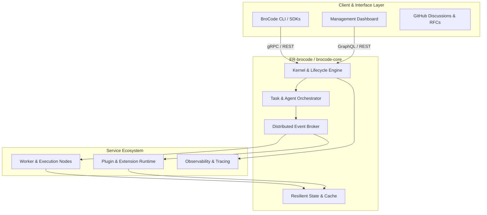

# ER.brocode (.github Master Repository)

Welcome to the central configuration, governance, and community health repository for the **ER.brocode** organization.

---

## 🚀 Mission & Vision

**ER.brocode** (*Engineering Resilience & Brotherly Code*) is committed to building modern, robust, resilient developer tools, distributed agent platforms, and scalable engineering ecosystems.

Our guiding pillars are:
1. **Resilient Engineering**: Architecting systems that gracefully degrade, recover autonomously, and maintain fault tolerance at scale.
2. **Collaborative Craftsmanship ("BroCode")**: Fostering an inclusive, high-standard peer engineering environment anchored in mutual respect, rigorous code reviews, and transparent decision-making.
3. **Open Innovation**: Embracing open-source ecosystems, modular architectures, and declarative developer workflows.

---

## 🏛️ Ecosystem Architecture

The ER.brocode organization is structured around modular, interoperable components designed for high-throughput, mission-critical applications:



### Key Repositories
- **[`ER-brocode/.github`](https://github.com/ER-brocode/.github)**: Master organization governance, profiles, shared workflows, and organization-wide guidelines.
- **[`ER-brocode/brocode-core`](https://github.com/ER-brocode/brocode-core)**: Core architecture runtime, foundational abstractions, orchestration engine, and plugin interfaces.

---

## 👥 Team Guidelines & Engineering Standards

### 1. Collaboration & RFC Process
- Every significant architectural pivot or new feature begins with a discussion in [GitHub Discussions](https://github.com/ER-brocode/.github/discussions) under the **Ideas** or **RFC** category.
- Consensus is reached through constructive peer review before code implementation commences.

### 2. Git & Branching Strategy
- **Default Branch**: `main` is production-ready, protected, and must always compile and pass all automated tests.
- **Feature Branches**: Branch names must adhere to conventional naming:
  - `feat/<topic>`: New features or capabilities
  - `fix/<bug-id>`: Bug fixes and patches
  - `docs/<subject>`: Documentation updates
  - `refactor/<module>`: Code restructuring without functional change
- **Commit Messages**: Follow [Conventional Commits](https://www.conventionalcommits.org/):
  ```text
  <type>(<scope>): <short summary>

  [optional body]
  [optional footer(s)]
  ```

### 3. Code Quality & Review Checklist
- Every Pull Request requires approval from at least two team members.
- Unit and integration test coverage must be maintained or increased with new additions.
- Ensure all static analysis, linting, and security vulnerability scans pass cleanly.
- Code should be clean, self-documenting, and accompanied by comprehensive markdown documentation.

### 4. Community & Code of Conduct
We maintain a zero-tolerance policy for harassment and discriminatory behavior. We expect all contributors and team members to communicate empathetically and support each other.

---

## 💬 Community & Discussions

We run all organization announcements, architectural proposals, Q&A, and community brainstorming via **GitHub Discussions**:
- [Join ER.brocode Discussions](https://github.com/ER-brocode/.github/discussions)
- Ask questions, share feedback, and help shape the roadmap.

---
*Maintained with ❤️ by the ER.brocode Engineering Team.*
